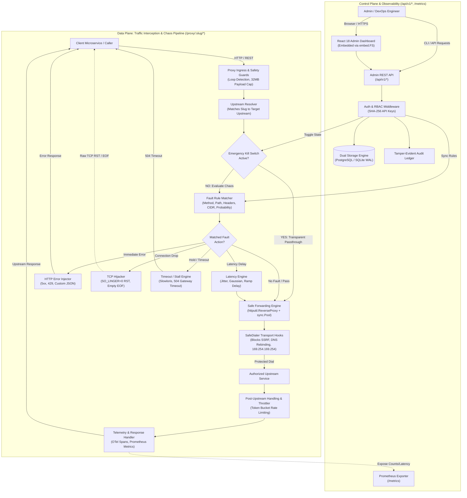

# FaultLine: Security-First Programmable Chaos Reverse Proxy

[](https://golang.org)
[](https://react.dev)
[](https://www.typescriptlang.org)
[](https://prometheus.io)
[](LICENSE)
[](https://github.com/Shashankj45/faultline/actions/workflows/ci.yml)
[](https://faultline-chaos-proxy.onrender.com)

> 🚀 **Live Cloud Console:** [https://faultline-chaos-proxy.onrender.com](https://faultline-chaos-proxy.onrender.com)  
> 📊 **Live Prometheus Metrics:** [https://faultline-chaos-proxy.onrender.com/metrics](https://faultline-chaos-proxy.onrender.com/metrics)  
> 🩺 **Live System Health:** [https://faultline-chaos-proxy.onrender.com/api/v1/health](https://faultline-chaos-proxy.onrender.com/api/v1/health)

**FaultLine** is an industrial-grade, programmable HTTP reverse proxy designed for reliability and systems engineers to systematically simulate adverse network conditions, service degradations, and cascading failures against microservices.

Sitting transparently between client applications and upstream backends, FaultLine injects fine-grained, deterministic, and probabilistic network faults without modifying application code.

---

## Architectural Blueprint



---

## Key Capabilities & Systems Engineering Highlights

### 1. Low-Level Networking & HTTP Internals
- **Raw Connection Hijacking (`http.Hijacker`)**: Takes control of the underlying TCP `net.Conn` to simulate real transport-layer disruptions:
  - **TCP Reset (RST)**: Sets `SO_LINGER` to `0` via `net.TCPConn.SetLinger(0)` and immediately closes the socket. This transmits an immediate TCP `RST` segment on the wire rather than a graceful `FIN` handshake, causing true `ECONNRESET` / `connection reset by peer` errors in client runtime networking stacks.
  - **Empty EOF**: Closes the socket without transmitting any HTTP response bytes, forcing client-side unexpected EOF errors.
  - **Mid-Stream Truncation**: Emits HTTP headers with a large `Content-Length`, sends partial data, and abruptly resets the socket mid-stream.
  - **Malformed HTTP Framing**: Transmits non-conformant garbage byte sequences to validate client HTTP parser robustness.
- **Context Cancellation Propagation**: Artificial latency and timeout holds listen directly to `r.Context().Done()`. When a client cancels or drops a request, sleeping routines instantly abort to eliminate goroutine leaks.
- **Zero-Allocation Stream Copying**: Implements `httputil.BufferPool` using a `sync.Pool` of 32KB byte buffers to avoid memory churn and heap fragmentation under heavy load.
- **Hop-by-Hop Header Stripping**: Implements strict RFC 7230 header sanitization (`Connection`, `Keep-Alive`, `Proxy-Authenticate`, `TE`, `Trailers`, `Upgrade`).

### 2. Security-First Architecture & SSRF Defenses
- **SSRF (Server-Side Request Forgery) Prevention**: FaultLine rejects all unregistered target destinations by default.
- **Fail-Closed Socket-Level DNS Rebinding Defense (`SafeDialer`)**: Domain names pointing to legitimate external IPs during registration can rebind to loopback or metadata IPs at dial time (TOCTOU). FaultLine enforces connection-time validation inside `net.Dialer.Control` socket hooks, strictly failing closed if any socket destination cannot be verified as an authorized IP.
- **Extended Infrastructure Blacklisting**: Permanently prohibits requests to:
  - AWS/GCP/Azure IMDSv4 (`169.254.169.254/32`) and AWS IMDSv6 (`fd00:ec2::254/128`).
  - Azure Wireserver Host Agent (`168.63.129.16/32`).
  - Unspecified networks (`0.0.0.0/8`, `::/128`) which route to loopback on host OS network stacks.
  - Link-local (`169.254.0.0/16`, `fe80::/10`) and multicast/broadcast ranges.
  - RFC 1918 private ranges unless explicitly authorized per upstream via strict configuration flags (`allow_localhost`, `allow_private_network`).
- **SSRF-Hardened Upstream Health Probing**: Health check monitor probes dispatch through isolated, SSRF-validated `SafeDialer` transports, ensuring that upstream DNS rebinds cannot probe internal cloud metadata via background health checks.
- **Proxy Loop Detection & Ingress Safety Bounds**: Tracks `X-FaultLine-Hops` header up to a strict ceiling of 10 hops (`508 Loop Detected`), and caps inbound request bodies at 32MB via `http.MaxBytesReader` to prevent memory exhaustion attacks.
- **Role-Based Access Control (RBAC) & $O(1)$ Atomic Bootstrap**: Distinguishes between `Admin`, `Operator`, and `Viewer` tiers. The bootstrap mode check is mediated by an atomic in-memory flag (`hasAPIKeys atomic.Bool`), ensuring $O(1)$ lock-free authentication without database table scans on each request.

### 3. Comprehensive Chaos Scenarios
| Chaos Scenario | Description | Configuration Details |
| :--- | :--- | :--- |
| **Artificial Latency** | Delays requests to simulate slow edge networks, overloaded backends, or routing hops. | Supports `fixed`, `uniform jitter` (min/max), `gaussian` (mean/stddev), and `gradual ramp` over experiment duration. Context-aware cancellation. |
| **HTTP Error Injection** | Injects custom HTTP error statuses and payloads without calling the upstream service. | Custom status codes (`500`, `502`, `503`, `504`, `429`), custom JSON bodies, and headers (`Retry-After`). |
| **Connection Drops / TCP RST** | Simulates abrupt connection drops, socket crashes, or network partitioning. | Raw socket hijacking (`TCP RST` via `SetLinger(0)`, `Empty EOF`, `Partial Body`, `Malformed Bytes`). Fully implements `http.Hijacker`. |
| **Timeout Simulation** | Simulates hung connections or slow upstream gateways. | `Client Stall` (holds connection), `504 Gateway Timeout` (delays then returns 504), and `Drip-Feed` (Slowloris chunks). |
| **Bandwidth Throttling** | Throttles ingress upload or egress download bandwidth to simulate cellular/edge links. | Token-bucket rate limiting (`rate.Limiter`) on stream readers and response writers with immediate context cancellation on client abort. |
| **Burst Spikes** | Injects periodic failure spikes for a duration $T_{burst}$ every cycle $T_{interval}$. | Temporal burst window calculation to stress test circuit breakers. |
| **Probabilistic Injection** | Applies faults probabilistically ($0.0 \le p \le 1.0$) using cryptographically secure random generation. | Fine-grained percentage control (e.g. 10% 503s, 50% 200ms latency). |

### 4. Zero-Downtime Emergency Kill Switch
- **Global & Atomic**: When activated, an $O(1)$ in-memory check instantly bypasses all active chaos rules across the entire proxy fleet.
- **Lifecycle Protection**: While the kill switch is engaged, API endpoints strictly reject starting or transitioning experiments to `running` with `409 Conflict`.
- **Fail-Open Architecture**: Internal proxy errors never disrupt critical traffic; requests default to transparent upstream passthrough.

### 5. Dual Storage Engine & Hot Cache
- **Dual-Driver SQL**: Seamlessly supports **PostgreSQL** in production environments and zero-dependency embedded **SQLite** (via modern pure-Go `modernc.org/sqlite`) for local development.
- **SQLite Referential Integrity & WAL**: Automatically configures `PRAGMA foreign_keys = ON;`, `PRAGMA journal_mode = WAL;`, and `PRAGMA busy_timeout = 5000;`.
- **Dynamic Proxy Invalidation**: Upstream configuration changes immediately evict and refresh cached reverse proxy instances (`EvictProxy`).
- **Lock-Free Hot Path**: When proxying incoming traffic, active experiments and upstream targets are read from an in-memory RCU-style cache, ensuring sub-microsecond rule evaluation.

---

## Live Cloud Deployment & Quick Demo

The proxy is deployed live on Render with built-in mock services (`orders`, `payments`, `inventory`):

| Resource | Live Cloud URL |
| :--- | :--- |
| **Interactive Web Console** | [https://faultline-chaos-proxy.onrender.com](https://faultline-chaos-proxy.onrender.com) |
| **Health Check Endpoint** | [https://faultline-chaos-proxy.onrender.com/api/v1/health](https://faultline-chaos-proxy.onrender.com/api/v1/health) |
| **Prometheus Metrics Stream** | [https://faultline-chaos-proxy.onrender.com/metrics](https://faultline-chaos-proxy.onrender.com/metrics) |
| **Live Upstreams Directory** | [https://faultline-chaos-proxy.onrender.com/api/v1/upstreams](https://faultline-chaos-proxy.onrender.com/api/v1/upstreams) |
| **Sample Reverse Proxy Ingress** | [https://faultline-chaos-proxy.onrender.com/proxy/orders/v1/orders](https://faultline-chaos-proxy.onrender.com/proxy/orders/v1/orders) |

### Quick Test via CLI
Test the live deployed cloud proxy directly without installing anything locally:

```bash
# 1. Probe system health
curl -s https://faultline-chaos-proxy.onrender.com/api/v1/health

# 2. Test reverse proxy routing to upstream orders service
curl -s https://faultline-chaos-proxy.onrender.com/proxy/orders/v1/orders

# 3. View live Prometheus scrape metrics
curl -s https://faultline-chaos-proxy.onrender.com/metrics | grep faultline_http
```

---

## Getting Started (Local Development)

### Prerequisites
- Go 1.23+
- Node.js 18+ (for frontend dashboard development)

### Quick Run (Standalone Binary)
FaultLine includes embedded mock services (`orders`, `payments`, `inventory`) and a pre-configured sample experiment out of the box:

```bash
# Clone the repository
git clone https://github.com/Shashankj45/faultline.git
cd FaultLine

# Build the Go binary (includes built React console)
go build -o faultline ./cmd/faultline

# Start the reverse proxy server
./faultline -port 8080
```

Once running:
- **Web UI Dashboard**: Open [http://localhost:8080](http://localhost:8080) in your browser.
- **Prometheus Metrics**: Available at [http://localhost:8080/metrics](http://localhost:8080/metrics).
- **API Health**: Available at [http://localhost:8080/api/v1/health](http://localhost:8080/api/v1/health).

---

## Live Experimentation & Testing

### 1. Clean Reverse Proxy Passthrough
Route a request through the proxy to the mock Order Service:
```bash
curl -i -X POST http://localhost:8080/proxy/orders/v1/orders \
  -H "Content-Type: application/json" \
  -d '{"customer": "enterprise-client", "items": 3}'
```
Response:
```http
HTTP/1.1 201 Created
Content-Type: application/json
X-FaultLine-Proxy: 1.0
X-FaultLine-Upstream: orders

{"created_at":"2026-11-22T07:42:38Z","items":3,"order_id":"ord_live_1","status":"confirmed","total_usd":149.99}
```

### 2. Observing Injected Chaos (Latency & 503 Spikes)
Route a payment charge through `/proxy/payments/v1/charges` where the pre-seeded Black Friday experiment is active:
```bash
curl -i -X POST http://localhost:8080/proxy/payments/v1/charges \
  -H "Content-Type: application/json" \
  -d '{"amount": 149.99}'
```
When an HTTP Error rule matches:
```http
HTTP/1.1 503 Service Unavailable
Content-Type: application/json
Retry-After: 15
X-FaultLine-Fault: http_error
X-FaultLine-Injected: true

{"error":"Payment Processor Overloaded","code":"PAYMENT_GATEWAY_THROTTLED"}
```

### 3. Triggering the Emergency Kill Switch
Instantly deactivate all chaos across the proxy:
```bash
curl -X POST http://localhost:8080/api/v1/killswitch \
  -H "Content-Type: application/json" \
  -d '{"global_active": true, "reason": "Incident #4021: Downstream alert triggered"}'
```
Re-running the payment charge now cleanly forwards to the upstream without delay or injected errors!

---

## Docker & Container Deployment

Deploy a production stack with FaultLine, PostgreSQL, and Prometheus:

```bash
docker-compose up -d
```

| Service | Port | Description |
| :--- | :--- | :--- |
| **FaultLine Proxy & Console** | `8080` | Reverse proxy ingress, REST API, and React Web Console |
| **Prometheus** | `9090` | Scrapes FaultLine `/metrics` every 5 seconds |
| **PostgreSQL 16** | `5432` | Relational store for upstreams, experiments, and audit logs |

---

## Running the Automated Test Suite

FaultLine features a comprehensive test suite covering SSRF defense, SQL storage migrations, fault engine interceptors, and reverse proxy routing:

```bash
# Run all Go tests
go test -v ./...

# Run the live end-to-end integration verification suite
powershell -ExecutionPolicy Bypass -File scripts/verify_live.ps1
```

---

## REST API Reference

| Method | Endpoint | Description |
| :--- | :--- | :--- |
| `GET` | `/api/v1/health` | Service health status |
| `GET` | `/api/v1/metrics/live` | Real-time sliding window stats (RPS, p95/p99 latency, error %) |
| `GET` | `/metrics` | Prometheus metrics scrape endpoint |
| `GET` | `/api/v1/killswitch` | Check emergency kill switch status |
| `POST` | `/api/v1/killswitch` | Activate or deactivate emergency kill switch |
| `GET` | `/api/v1/upstreams` | List all registered upstream services with health telemetry |
| `POST` | `/api/v1/upstreams` | Register a new upstream with SSRF validation |
| `DELETE`| `/api/v1/upstreams/{id}` | Delete an upstream registration |
| `GET` | `/api/v1/experiments` | List chaos experiments |
| `POST` | `/api/v1/experiments` | Create a new chaos experiment |
| `POST` | `/api/v1/experiments/{id}/status` | Update lifecycle state (`running`, `paused`, `completed`, `aborted`) |
| `POST` | `/api/v1/experiments/{id}/rules` | Attach a fault rule to an experiment |
| `DELETE`| `/api/v1/rules/{id}` | Delete a fault rule |
| `GET` | `/api/v1/audit-logs` | Query append-only audit trail |
| `POST` | `/api/v1/test-studio/dispatch` | Dispatch simulated test traffic and inspect response headers |

---

## License

Apache License 2.0. Built for production reliability and resilience engineering.
